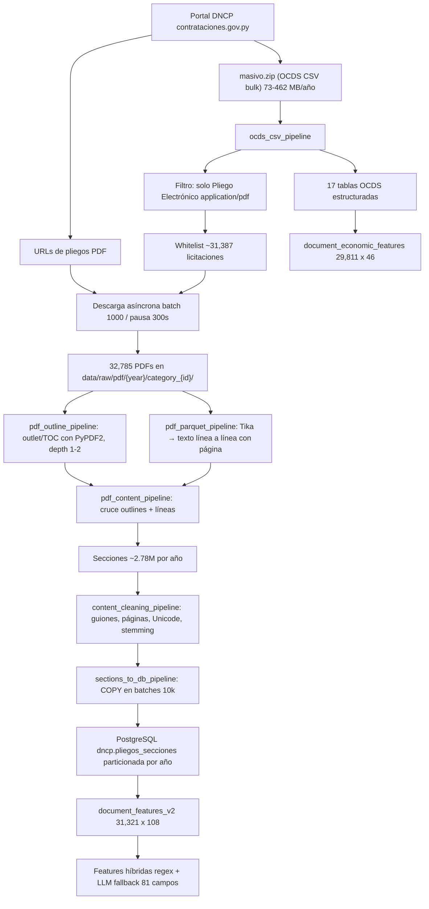
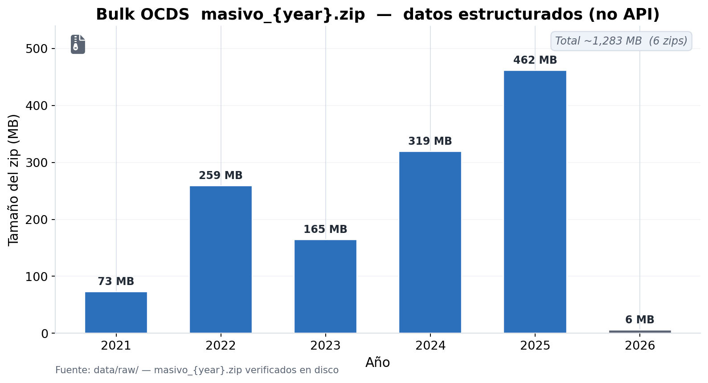
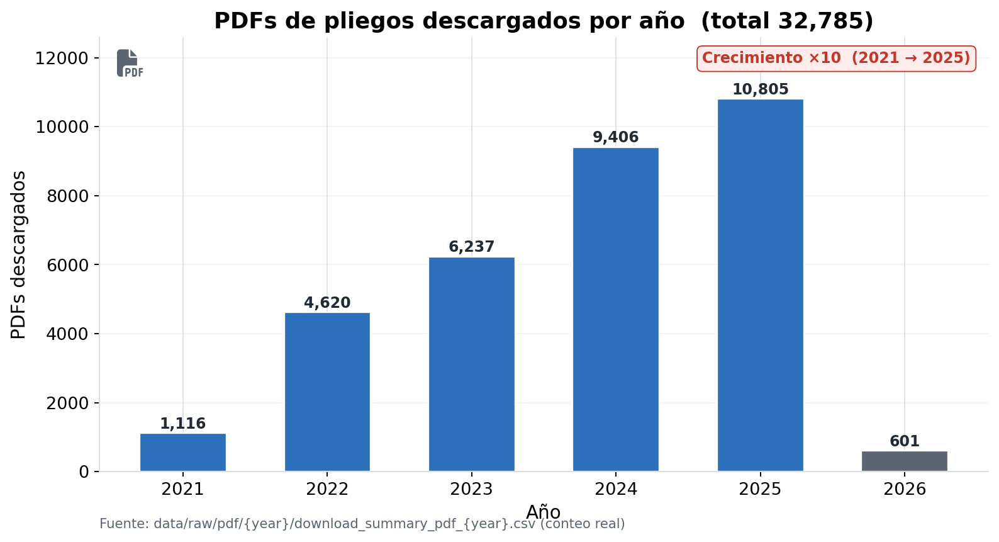
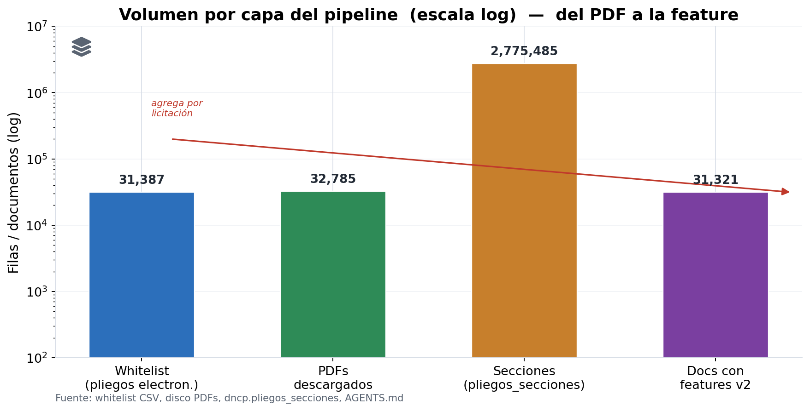
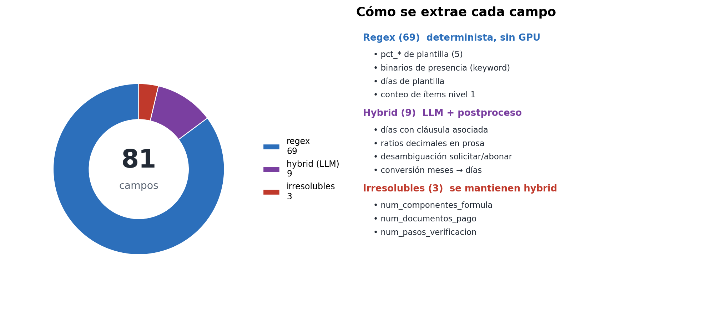
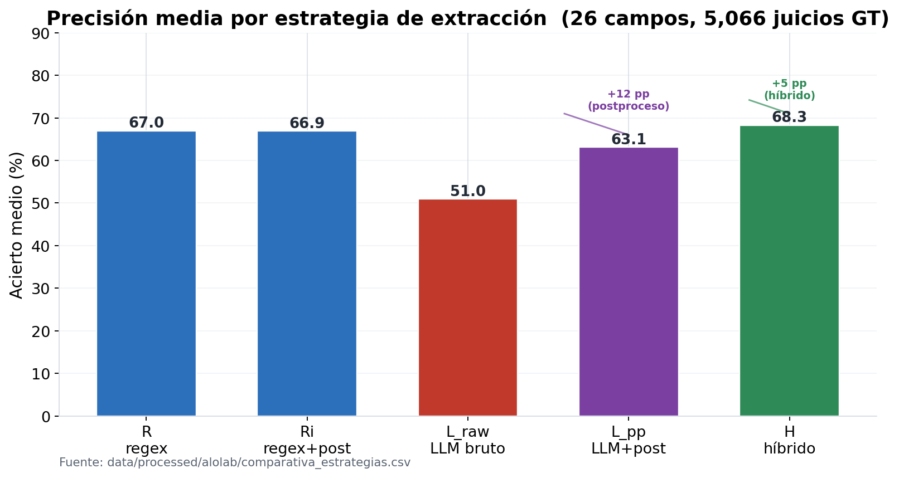

# Flujo de datos del pipeline — de las fuentes a la base (con gráficas)

> Documento de apoyo para reunión con tutores. Todos los números están verificados contra el
> repositorio (HOJA DE HECHOS del agente) o contra la base `dncp`. En inglés/ES: aquí en español.

## Diagrama general del flujo

## 1. Fuente estructurada: OCDS en bulk (no API)

Los datos estructurados (licitaciones, oferentes, adjudicaciones, contratos, pagos, ítems,
consultas, enmiendas, protestas…) provienen del **bulk mensual/anual `masivo.zip`** del portal, en
formato OCDS CSV. **Elección clave**: se usó el bulk y no la API en vivo del DNCP.

- **Por qué**: descarga completa y reproducible del dataset; evita los límites de tasa de la API y
  permite re-ejecutar el pipeline desde cero en cualquier momento.
- **Tamaños verificados**: 2021=73.0 MB · 2022=258.7 · 2023=164.6 · 2024=319.2 · 2025=462.0 ·
  2026=5.9 (parcial).

*Figura 1 — Volumen del bulk OCDS descargado por año (datos estructurados).* [NO CONFIRMADO el motivo
"rate limit" exacto en docs; solo la elección de bulk CSV], según HOJA DE HECHOS.

## 2. Filtro de calidad: solo pliegos electrónicos

De `tender_documents` (lista de documentos de cada licitación), el pipeline conserva únicamente
registros con formato `application/pdf` y tipo **"Pliego Electrónico de Bases y Condiciones"**.
El resto (pliegos escaneados, otros formatos, documentos distintos) se descarta **antes** de
descargar nada.

- Whitelist resultante: `ten_documents_pliego_pdf_every_year_filtered.csv` — **~31,387 licitaciones**.
- Lógica: `src/tasks/extract_tender_documents.py` + filtro de la clase `OcdsCsvPipeline`
  (log geónico "Filtradas %d licitaciones sin pliego electrónico").

## 3. Descarga óptima de los PDFs

- Descargador **asíncrono concurrente** (`file_async_downloader.py`, `async_download_pipeline.py`):
  batches de 1,000 con pausa de 300 s entre batch para no saturar el portal.
- Maneja `.zip/.rar` embebidos: descomprime y extrae el PDF interno.
- Renombrado canónico `{year}_{categoria_id}_{nro_licitacion}.pdf` y organización
  `data/raw/pdf/{year}/category_{id}/`.
- **32,785 PDFs** en disco (2021=1,116 · 2022=4,620 · 2023=6,237 · 2024=9,406 · 2025=10,805 ·
  2026=601).

*Figura 2 — PDFs de pliegos descargados por año.*

## 4. Parsing con Tika y estrategia por outlines

**Extracción de texto**: cada PDF se convierte a texto plano con **Apache Tika** (contenedores
Podman paralelos; `src/utils/tika_init.py` con puertos 9998/9999). Salida: **línea por línea** con
página asociada (`combined_documents_all_years.parquet`, ~1.93 GB, ~50M líneas).

**Estrategia estructural (outlines)**: además del texto plano, de cada PDF se extrae su **índice /
bookmarks (outlines)** con PyPDF2:
- `PDFOutline(document_id, title, page, depth, nro_licitacion, category_id, year, line_number)`.
- Se usan los dos primeros niveles jerárquicos (capítulos y secciones).

**Cruza outlines + líneas → secciones** (`pdf_content_pipeline.py`):
1. Normalización del texto (`normalize_exact`: NFKD, sin acentos ni puntuación, minúsculas) para
   matchear el título del índice contra el cuerpo.
2. A cada título se le asigna su **línea de inicio** dentro del documento.
3. `determine_section_end` resuelve el límite de cada sección con **5 casos**:
   - *Caso 1*: misma página → corte en la línea del siguiente título.
   - *Casos 2 y 3*: entre páginas → la sección **corta al final de la página anterior** (fix del
     Issue A: un subtítulo "Adenda" que absorbía páginas ajenas).
   - *Caso 4*: límite virtual de nivel 1 (búsqueda hacia adelante).
   - *Caso 5*: marcador sintético `__END_OF_DOCUMENT__` para que la última sección tenga fin
     (Issue C).
4. Se deduplican los títulos TOC que coinciden con contenido real (commit `09e9f50`).

Resultado: **~2.78M secciones de pliego** (`pliegos_secciones`).

## 5. Limpieza del texto

`content_cleaning_pipeline.py` aplica, en orden:
1. Elimina `\r` (retornos de carro).
2. **Une guiones de fin de línea** (`"docu-\nmento"` → `"documento"`).
3. Normaliza espacios múltiples → espacio simple.
4. Elimina líneas vacías y líneas de solo números de página.
5. Reemplaza caracteres Unicode problemáticos.
6. Stemming básico en español.

Salida por sección: `content_clean[]` (array de líneas), `content_text` (texto plano),
`content_length_clean`. Se **descartan secciones vacías** (longitud 0). Además se calcula
`word_count` (media 204.5 palabras/sección, verificada).

## 6. Carga a PostgreSQL (idempotente)

- Tabla `dncp.pliegos_secciones` **particionada por año** (`LIST(year)`, particiones `_2021.._2025`).
- Índices: `brin(page)` (rango), `gin` trigram sobre `title_normalized` (búsqueda textual), unique
  `(nro_licitacion, title, line_start, year)`.
- Carga con **COPY** (`execute_values`) en batches de 10,000 filas, commit por batch (evita OOM del
  WAL y permite recuperación parcial).
- Upserts `ON CONFLICT DO NOTHING` → re-ejecutable sin duplicar.
- **Checkpoint por año** (`.sections_db_done_{year}`) para saltar años ya procesados.

## 7. De las secciones a las features (lo que el tutor ve como resultado)

| Capa | Artefacto | Filas | Qué es |
|---|---|---|---|
| Whitelist | CSV filtrado | ~31,387 | Licitaciones con pliego electrónico |
| PDFs | data/raw/pdf | 32,785 | Documentos descargados |
| Secciones | `pliegos_secciones` | ~2.78M | Texto por sección de pliego |
| Features v2 | `document_features_v2` | 31,321 × 108 | 81 campos (69 regex + 12 hybrid) |
| Económicas | `document_economic_features` | 29,811 × 46 | Competencia, colusión, ejecución |

*Figura 3 — Volumen por capa del pipeline.*

*Figura 4 — Esquema de campos de `document_features_v2`: 69 regex + 12 hybrid.*

## 8. Decision abierta (🟡): regex vs LLM sobre los datos limpios en base

Los datos ya están limpios. La pregunta es cómo extraer/transformar los campos del texto de pliego:
- **Regex determinista** — reproducible, cero costo por documento, detecta patrones plantilla con
  100% de acierto en campos uniformes; respaldo OCP (2016) y World Bank (2011).
- **LLM con postproceso** — cubre lo semántico ("experiencia técnica en X", "liquidez mayor o igual
  a N"); respaldo de Katona & Fazekas (2024) y Peppes et al. (2026). Llama 3.1 8B-AWQ local logró
  100/100 en golden set humano.

*Figura 5 — Precisión media por estrategia (26 campos, GT 5,066 juicios). H=65.1 > L_pp=63.1 >
L_raw=51.0 > R=61.0.* (Fuente: `comparativa_estrategias.csv`.)

**Estado de la decisión**: pendiente 🟡. Propuesta: mantener el **híbrido** (regex por defecto si hay
patrón plantilla, LLM como fallback con capa de postproceso determinista compartida).